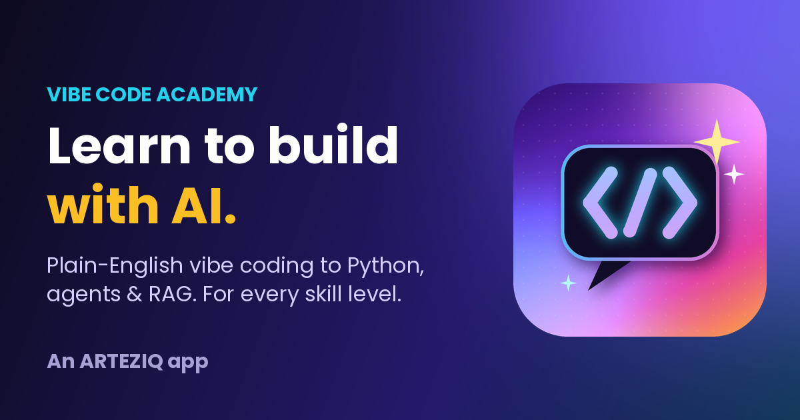

# Vibe Code Academy — v1.1.2

**▶ Live app (Cloudflare):** https://vibecode.arteziq.com/
**GitHub repo:** https://github.com/DavidFliesen/Vibe-Code-Academy

*Learn to build with AI — in plain English first, then in Python.*
An **ARTEZIQ** app, created by David "SunTzu" Fliesen.

**Latest AI update:** none yet — the first weekly run will add one.



---

## What it is

Vibe Code Academy is a free, installable, offline-ready Progressive Web App (PWA) that teaches people of every age and skill level how to work with AI: prompting, vibe coding (building apps by describing them), Python for AI, and hands-on AI engineering (LLM APIs, structured output, tool use, agents, RAG, evals and safety). An AI curriculum agent keeps it current every week.

No account, no tracking, no API keys for learners. Progress is saved on the learner's own device.

## Features

- **4 learning tracks, 24 lessons**, each with a 3-question quiz
  | Track | Level | Lessons |
  |---|---|---|
  | 🧭 AI Explorer | Beginner - all ages | 5 |
  | 🎧 Vibe Coder | Beginner to Intermediate | 6 |
  | 🐍 Python Builder | Intermediate | 6 |
  | 🤖 AI Engineer | Advanced | 7 |
- **📰 This week in AI** — a weekly, sourced news briefing written for learners, plus "This week's focus" lesson picks. Lessons the agent adds or refreshes are tagged NEW or UPDATED.
- **Real Python in the browser** (Pyodide 0.29.5) — 12 runnable lesson examples plus a full **Python Playground**. Runs in a Web Worker so infinite loops can be stopped; downloads once (~10 MB) and is cached for offline use.
- **`ai_sim`** — a built-in *simulated* LLM (`py/ai_sim.py`) for practicing real API patterns with no key and no cost. Advanced lessons also show the real Colab + Anthropic SDK version.
- **Prompt Lab** — *Builder* (5-part recipe, 8 templates), *Checkup* (on-device prompt scoring), *App Brief* (pro-quality vibe coding brief)
- **Gamification** — XP, 7 levels, 15 badges, daily streaks; shareable PNG certificates per track
- **AI Glossary** — 31 terms in plain English, searchable
- Kid-friendly callouts, larger-text toggle, onboarding, export/import of progress

## Weekly AI curriculum agent

Every Monday a GitHub Action runs `.github/scripts/update_academy.py`:

1. **Research** — Claude (claude-sonnet-5-5) uses web search (up to 12 searches) to find what changed in AI tools, models, agents and workflows.
2. **Plan** — Claude proposes news items, lesson spotlights, small lesson edits, new glossary terms and tips, and occasionally a brand-new lesson.
3. **Self-review** — a second Claude pass fact-checks every proposed change against the sources.
4. **Validate** — Python checks everything: every source URL must have appeared in the real search results, quizzes must be well-formed, and lesson code must actually run. Nothing is ever deleted.
5. **Publish** — the version number goes up, this README is regenerated, and a **pull request** opens with a summary of every change and every rejected idea. Cloudflare builds a preview of the PR so you can try it before merging. Merge it to go live.

### One-time setup

1. **API key:** repo **Settings → Secrets and variables → Actions → New repository secret** — name `ANTHROPIC_API_KEY`, value = your Claude API key.
2. **Allow pull requests:** **Settings → Actions → General → Workflow permissions** — choose *Read and write permissions* and tick *Allow GitHub Actions to create and approve pull requests*.
3. **Test it free:** **Actions → Weekly AI Curriculum Update → Run workflow**, tick **mock**. This uses sample data (no API cost) and opens a test PR you can close.

### Optional settings (Settings → Secrets and variables → Actions → Variables)

| Variable | Default | What it does |
|---|---|---|
| `VCA_MODEL` | `claude-sonnet-5-5` | Claude model the agent uses |
| `VCA_MAX_SEARCHES` | `12` | Max web searches per weekly run (cost control) |
| `VCA_REVIEW` | `true` | Set `false` to skip the self-review pass |
| `VCA_AUTO_PUBLISH` | `false` | Set `true` to commit straight to main and skip the review PR |

## Hosting on Cloudflare

The app is plain static files served by Cloudflare Workers, connected to this GitHub repo. Every commit to main redeploys automatically, and pull requests (like the weekly AI updates) get their own preview link.

1. Cloudflare dashboard → **Workers & Pages → Create application → Import a repository** → pick **Vibe-Code-Academy**.
2. Project name **vibe-code-academy**. Build command **blank**. Deploy command **`npx wrangler deploy`**. Preview command **`npx wrangler preview`**.
3. Leave **Enable Preview builds** on and **Protect with Cloudflare Access** off (the site is public).
4. **Deploy.**
5. **Custom domain:** in the Worker, **Settings → Domains & Routes → Add → Custom domain** → `vibecode.arteziq.com`. Cloudflare creates the DNS record and HTTPS certificate automatically (arteziq.com must be an active domain in your Cloudflare account).

The app also stays reachable at `vibe-code-academy.dfliesen.workers.dev`, which Cloudflare uses for pull-request preview links. The home page tells search engines that `vibecode.arteziq.com` is the official address.

If the address ever changes, update `liveUrl` in `js/app.js`, the `canonical` / `og:url` / `og:image` tags in `index.html`, and `LIVE_URL` in `.github/scripts/update_academy.py`.

Config files:
- `wrangler.jsonc` — tells Cloudflare to publish the repo root as the website.
- `.assetsignore` — keeps repo-only files (`.github`, `README.md`, `wrangler.jsonc`) off the public site.
- `_headers` — security headers (a Content Security Policy that only allows the app's own files plus the Pyodide engine from `cdn.jsdelivr.net`) and caching rules (`sw.js` and the home page always re-checked; images cached for a week).

## File structure

```
index.html                         App shell
manifest.webmanifest               PWA manifest
sw.js                              Service worker (offline cache)
_headers                           Cloudflare security + caching headers
wrangler.jsonc / .assetsignore     Cloudflare Workers config / files kept off the site
css/app.css                        Styles (hardcoded hex colors)
js/app.js                          App logic, router, views, XP/badges, certificates, news
js/promptlab.js                    Prompt Builder, Checkup and App Brief
js/python.js / js/py-worker.js     Python runner + Pyodide Web Worker
py/ai_sim.py                       Simulated LLM used in lessons and the Playground
data/lessons.js                    Tracks, lessons, quizzes, glossary and tips
data/updates.js                    Weekly AI news, spotlights and changelog
assets/                            Icons, logo, social preview image
.github/workflows/weekly-update.yml  Weekly agent schedule
.github/scripts/update_academy.py    The curriculum agent
.github/scripts/sample_run.json      Sample data for free test runs
```

All app JavaScript is ES5 (no `let`/`const`, arrow functions or template literals).

## Customizing

- **Your bio and links:** the `CONFIG` block at the top of `js/app.js`.
- **Lessons:** `data/lessons.js` (block types: `p`, `h`, `list`, `tip`, `warn`, `kid`, `prompt`, `compare`, `code`, `codeview`, `activity`; text supports `**bold**`, `*italic*`, `` `code` ``).
- **Manual release:** bump `VERSION` in `sw.js` and `version` in `js/app.js`, then run `python .github/scripts/update_academy.py --readme-only`.

## Version history

- **v1.1.2** (2026-11-12) — New home at vibecode.arteziq.com: share links, social preview tags, canonical address and README updated.
- **v1.1.1** (2026-11-12) — Cloudflare Workers hosting (wrangler.jsonc + .assetsignore so repo tools stay private); fixed offline reload caching the redirected index.html.
- **v1.1.0** (2026-11-10) — Weekly AI curriculum agent (GitHub Action + Claude web search) with self-review and validation; new "This week in AI" section, weekly lesson spotlights, and NEW/UPDATED lesson tags.
- **v1.0.1** (2026-11-10) — Cloudflare Pages hosting with security and caching headers; quiz answers shuffled; small-phone layout, accessibility and service-worker fixes.
- **v1.0.0** (2026-11-10) — First release: 4 tracks / 24 lessons with quizzes, in-browser Python with ai_sim, Prompt Lab, XP, badges, certificates, sharing, glossary and offline PWA.

---

© ARTEZIQ · Created by David "SunTzu" Fliesen · [Portfolio](https://davidfliesen.github.io)
